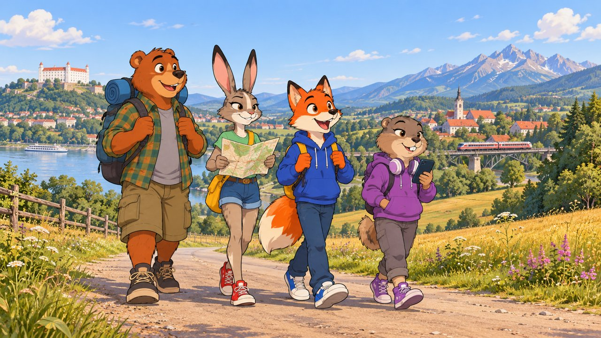
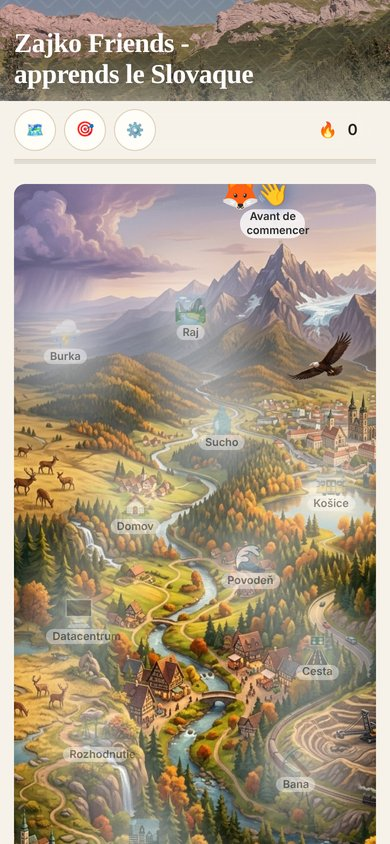
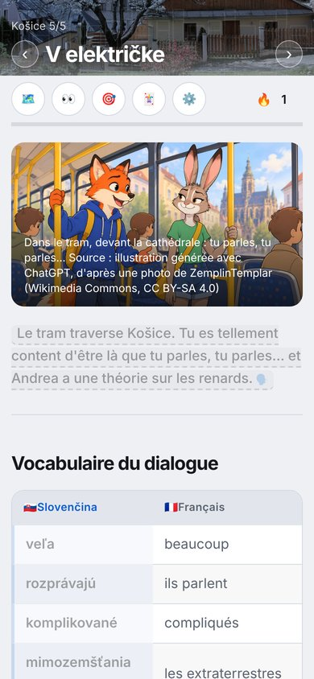
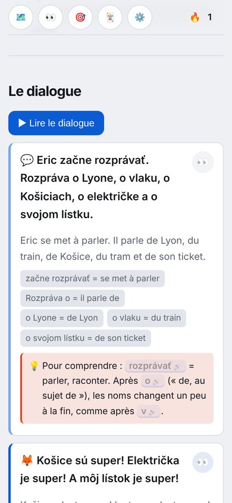
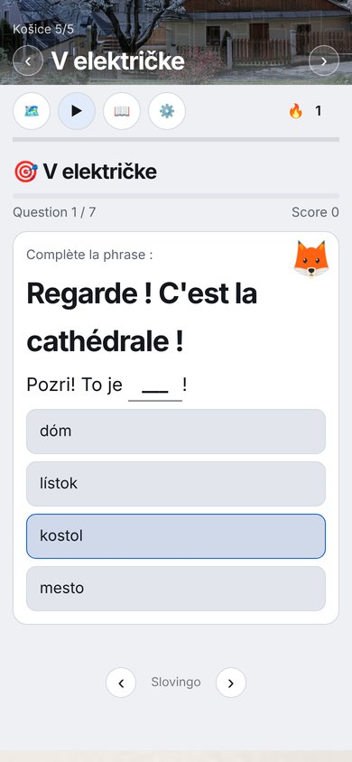

# Zajko Friends 🇸🇰 🇫🇷

🌐 **Le cours en ligne : [lstux.github.io/Slovingo-sk-fr-friends](https://lstux.github.io/Slovingo-sk-fr-friends/)**

Un cours de slovaque pour les 12-16 ans… qui se lit comme une histoire ! :)

## L'histoire

Tu te souviens du petit renard des Tatras, dans le cours des enfants ? C'est toi, quelques années plus tard. Tu as 15 ans, tu habites à Lyon, et tu as gardé un souvenir génial de ces vacances en Slovaquie. Alors tu y retournes. Tout seul, oui, oui. ^^

Et à Košice, dans un tram, par le plus grand des hasards… Andrea ! La hase, ton amie d'enfance. Elle a 16 ans, elle a changé, et visiblement il s'est passé des choses pendant ces années. Elle n'a pas trop envie d'en parler.

Puis le seul point d'eau du coin disparaît. Et là, on ne peut plus juste regarder : avec Andrea, et bientôt Maťo l'ours et la petite Katka (qui déteste qu'on l'appelle comme ça), vous partez à travers la Slovaquie jusqu'à Bratislava. Pour être entendus.

Sécheresse, orage dans les Tatras, inondation, une drôle de route en construction, un datacenter, une mine… Le monde part un peu en vrille. Mais bon, on prend quand même le train, et on se dispute quand même pour le dernier morceau de gâteau. :D

## Aperçu

  
  
  
  

## Comment ça marche

- **Une série = un chapitre.** Mis bout à bout, les dialogues font un vrai petit roman : 12 chapitres et un épilogue, de Košice à Bratislava.
- **Que des dialogues.** Les fiches 1 à 4 donnent les mots et la grammaire avec de petites scènes, les fiches 5 et 6 racontent l'épisode, avec un narrateur 💬 qui donne le décor.
- **Tout s'écoute** : on touche une phrase et elle est lue. Le bouton 👀 donne la traduction, puis le détail morceau par morceau.
- **Des exercices** pour chaque fiche, et une carte de la Slovaquie en page d'accueil, qui se dévoile au fil du voyage.
- **Niveau** : on part du cours des enfants (même fait il y a longtemps, pas de panique, il y a une remise en route au début), et on vise un bon A2 à la fin.

## 🎮 Jeux Zajko

Deux petits jeux dans l'univers du cours, qui reprennent ses dialogues :

- **Zajko Run** (plateformes) et **Zajko Quest** (aventure, chapitres Košice et Sucho), à jouer dans le navigateur : **[lstux.github.io/Slovingo-sk-fr-friends/games/](https://lstux.github.io/Slovingo-sk-fr-friends/games/)** (sources dans [`web-games/`](./web-games/)).
- Les mêmes jeux en firmware pour l'**ODROID-GO** (ESP32) : [`esp32/zajko-run`](./esp32/zajko-run/) et [`esp32/zajko-quest`](./esp32/zajko-quest/). Oui, j'ai craqué. ^^

## La famille

Le cours a deux cousins, dans le même univers du renard et de la hase :

- 🧒 **[Slovingo-sk-fr-kids](https://github.com/lstux/Slovingo-sk-fr-kids)** : pour les 8-12 ans, les vacances dans les Tatras. C'est là que tout commence.
- 🚗 **[Slovingo-sk-fr](https://github.com/lstux/Slovingo-sk-fr)** : pour les grands, un roadtrip de Bratislava à Košice, avec un renard devenu oncle.

## Pourquoi ce cours ?

Le cours des enfants marchait bien, mais une fois grands, les personnages avaient envie d'autre chose que de compter les marmottes. Alors j'ai voulu une vraie histoire, avec de l'aventure, de l'humour, et un peu de mystère. Le slovaque, on l'apprend au passage, presque sans s'en rendre compte. Enfin, c'est l'idée ! :)

## Où on en est

- Les 13 chapitres sont écrits.
- **Le slovaque est à faire relire par des natifs.** Si tu parles slovaque et que quelque chose sonne bizarre, n'hésite pas à ouvrir une issue, ça m'aidera vraiment beaucoup.
- Les illustrations des épisodes arrivent au fur et à mesure.

Les remarques, corrections et idées sont les bienvenues !

## Crédits

- **Photos** : [Wikimedia Commons](https://commons.wikimedia.org/) et autres sources libres, avec les auteurs et licences dans [`img/credits.md`](img/credits.md).
- **Illustrations** : générées par IA à partir de mes personnages (prompts dans [`docs/Prompts-illustrations.md`](docs/Prompts-illustrations.md)).
- **Moteur** : le cours tourne sur [Slovingo](https://github.com/lstux/Slovingo), mon petit framework pour apprendre les langues.

## Pour les curieux : le dépôt

- `md/` : les fiches, au format Slovingo Markdown.
- `exercises/` : les exercices écrits à la main.
- `img/` : les photos, les illustrations et leurs crédits.
- `docs/` : le concept, le format des fiches, la progression, et l'histoire complète en slovaque (attention, ça spoile !).
- `web-games/` et `esp32/` : les jeux.

**Déploiement** : à chaque push sur `main`, le workflow `.github/workflows/pages.yml` construit le site avec [Slovingo](https://github.com/lstux/Slovingo) et le publie sur **https://lstux.github.io/Slovingo-sk-fr-friends/**. L'`url_path` est adapté au moment du build, sans modifier `lang.json` dans le repo. Le workflow `build-release.yml` (release en tarball, à lancer à la main) est toujours là.

---

*Slovingo est libre et open-source, sous licence [GPL-3.0](./LICENSE).*
